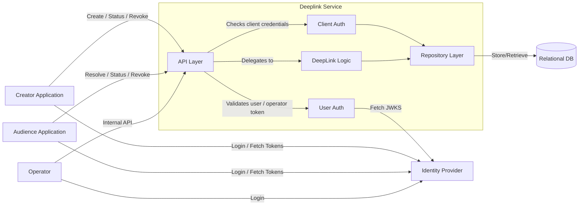
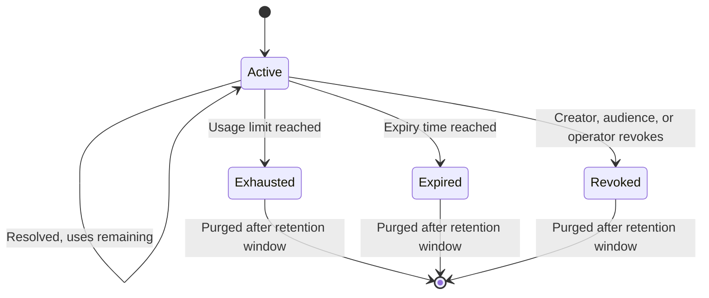

# Architecture

This document defines the high‑level architecture of the Deeplink Service.
It describes the system’s components, responsibilities, interactions, and the key design decisions that shape the platform.

The Deeplink Service provides a secure, centralized mechanism for generating and resolving deep links between client applications, with a configurable usage limit per link (single‑use by default, optionally multi‑use) and a bounded lifetime. It enforces audience isolation, optional user binding, and deterministic routing through audience/scope/platform mappings.

Deferred work and open questions are tracked separately in [Future Improvements](future_improvements.md).

## High‑Level Architecture

## Component Responsibilities

### API Layer

- Exposes the public REST API (`/api/v1`) and the internal API (`/internal/v1`)
- Validates request structure and input limits (see [Input Limits](#input-limits))
- Delegates authentication to Client Auth and User Auth
- Delegates business logic to DeepLink Logic
- Normalizes error responses (401/403/404)

### User Auth

- Validates IdP-issued access tokens using JWKS from the IdP (see [Token Validation](#token-validation)):
  - User tokens, for private links
  - Operator tokens, for the internal API
- Extracts the ``sub`` claim for private link enforcement and operator attribution
- Caches JWKS keys for performance

### Client Auth

- Validates client credentials using Basic Auth against stored client records
- Resolves the authenticated client's id and audience for downstream ownership checks

### DeepLink Logic

- Loads audience/scope/platform mappings
- Generates link IDs
- Builds target URLs (see [Target URL Construction](#target-url-construction))
- Applies TTL and usage‑limit rules
- Enforces audience isolation
- Enforces private link semantics (user binding)
- Increments usage count on each successful resolution
- Emits an audit event for every audited action (see [Audit](#audit))

### Repository Layer

Provides DB-abstract persistence access to:

- Clients
- Scope mappings
- Deeplinks
- Ensures atomic updates (e.g., incrementing a link's usage count)
- Encapsulates all SQL/ORM interactions

## Interaction With the Identity Provider (IdP)

The Deeplink Service relies on a shared IdP used by all clients and operators.

The service:

- Fetches JWKS keys to validate user and operator tokens
- Does not issue or refresh tokens
- Does not redirect users to the IdP

Clients and operators:

- Authenticate directly with the IdP
- Pass their access tokens to the Deeplink Service when needed

This keeps the Deeplink Service free of session state and avoids coupling it to IdP‑specific login flows.

### Token Validation

Every access token presented to the service (user or operator) must carry an ``aud`` claim that includes the Deeplink Service. A token issued only for another resource server, such as the audience app's own API, is rejected even if its signature, issuer and expiry are valid.

Without this check, any service that legitimately receives a user's token for its own API could replay it here to create or resolve private links as that user. Enforcing ``aud`` limits accepted tokens to those the user, or the app acting for the user, deliberately requested for the Deeplink Service.

Operator tokens must additionally carry the configured operator role/group claim. A valid token without it is rejected with 403 on the internal API.

Generic JWT hygiene (allowed algorithms, ``exp``/``nbf``/``iss``, clock skew, key refresh) is in [Implementation Notes](implementation_notes.md#jwt-and-jwks-validation-hygiene).

## Routing Model

Deeplinks are routed using a deterministic mapping: `(audience, scope, platform) → base target URL`

### Audience

- A stable, semantic identifier (e.g., billing-service)
- Not tied to credentials

### Scope

- Logical flow identifier (e.g., onboarding:continue)
- Defined by convention and used for routing within an audience

### Platform

- Enum: WEB, ANDROID, IOS
- Determines which target URL to use by describing the platform being routed *to*

### Target URL Construction

The target URL is the mapping's base URL with two query parameters added: the link id, and a privacy hint saying whether the link is private. Their exact names are part of the [API Contract](api_v1.md#create-response-json).

Rules:

- The base URL may already contain query parameters, and may be a custom-scheme app URI (e.g. ``myapp://onboarding``). Parameters are appended to the existing query, never replacing it, and any fragment is kept at the end of the URL.
- The two parameter names are reserved. A scope mapping whose base URL already uses either of them is rejected when the mapping is created or updated.
- The target URL is built once at creation and stored. Later mapping changes don't affect existing links.

## Input Limits

| Input | Default | Limit |
| --- | --- | --- |
| Lifetime (TTL) | 10 minutes | 1 second to one year |
| Usage limit | 1 (single-use) | 1 to 10 |
| User context | none | 16 KiB of serialized JSON (server-configurable) |

Requests outside these limits are rejected at creation.

## Link Lifecycle

### Creation

1. Creator authenticates
1. Input limits are checked
1. If a user token is present, it is validated and the link becomes private, bound to the token's ``sub``
1. Mapping is loaded
1. Link ID is generated
1. Target URL is constructed
1. Expiry time and usage limit are set, applying defaults
1. Link and optional user context are stored, together with a "link created" audit event
1. Response includes link ID and target URL

### Resolution

1. Audience authenticates
1. If an idempotency key matches an earlier request, the replay checks are applied (see [Idempotent Resolution](#idempotent-resolution))
1. Link is loaded
1. Audience check: the link's audience must be the caller's audience
1. Status check: the link must not be expired, exhausted, or revoked (skipped for an idempotent replay)
1. If the link is private, the user token is required and validated, and its ``sub`` must match the link's
1. Usage count is incremented atomically
1. User context is returned

The checks run in this order, and the first failure decides the response. Every check up to and including the status check returns 404, so a caller learns nothing about a link that isn't theirs or isn't usable. The 401/403 private-link errors are only reachable for a usable link addressed to the caller's own audience.

For public links the user token header is ignored, not validated. Validating it would cost a signature check and add an IdP dependency for no effect, since nothing about a public link depends on the user.

### Idempotent Resolution

A resolve request may carry an idempotency key. Its first outcome is stored, bound to the audience client, the link id, and (for private links) the user ``sub``. A replay within the idempotency window:

- With a different link id, is rejected with 422, never served from the stored outcome
- For a private link, still requires a valid user token whose ``sub`` matches the stored one, so the stored user context is never returned to a different user
- Otherwise returns the stored outcome without consuming another use

A replay still goes through the audience check and, for private links, the user check. It skips the status check: the link may have become exhausted because of the very request being replayed, and the stored outcome reflects the state at the time of the first request.

The stored outcome contains the user context and is held only for the idempotency window.

### Revocation

1. The creator client, the audience client, or an operator (internal API, no ownership check) authenticates
1. Link is loaded
1. If the link is already revoked, expired, or exhausted, the call succeeds with no state change, and the attempt is recorded as an audit event
1. Otherwise the link is marked revoked, recording when and by whom
1. Resolution of a revoked link is treated identically to expired/exhausted (404)

Revocation is a soft delete: the row and its usage history are preserved. Physical removal happens later and separately, via the retention/purge job (see [Retention and Purge](#retention-and-purge)), not as a side effect of revoking.

### Link Lifecycle Diagram

A multi-use link that has been partly used stays Active: it behaves exactly like an unused one, so a separate state would add nothing.

## Retention and Purge

Revocation and hard deletion are two different operations with two different authorization models, and are kept separate deliberately: revocation is a client-facing action scoped to link ownership, while hard deletion is a data-retention concern that has nothing to do with who owns the link.

A scheduled internal job hard-deletes inactive links (with their user context) once the retention window has passed since they became inactive:

| State | Became inactive at |
| --- | --- |
| Expired | Expiry time |
| Exhausted | Time of the final use |
| Revoked | Revocation time |

It never deletes an active link. Since every link has a TTL of at most one year, every link eventually becomes inactive and is purged. The retention window is an operational/compliance parameter left for the operator to configure.

Purging a link does not purge its audit events; those follow their own retention (see [Audit](#audit)).

## Internal Operations API

The internal API (see [API Contract](api_v1.md#internal-api-ops)) gives operators:

- Link inspection and listing, regardless of ownership
- Link revocation, regardless of ownership
- Client management: create, update, deactivate
- Scope mapping management: create, update, remove
- Audit event listing

Access is controlled in two layers:

- **Operator identity**: every call carries the operator's own IdP access token, validated as described in [Token Validation](#token-validation) and requiring the operator role claim. There is no shared service token, so every operator action is attributable to an individual operator.
- **Network**: the internal API is not reachable from the internet (internal VPC/private ingress).

It is a different base path rather than a bypass flag on the public endpoints, so the public API's client-scoping guarantee (creator/audience only) is never conditionally relaxed by a header or credential type that could be forged or misconfigured.

## Audit

Every state-changing action is recorded as an audit event attributable to the actor that performed it. Audit events answer *who did what, to which resource, and when*. They are separate from the audit fields on each entity (see [Data Model § Audit Fields](data_model.md#audit-fields)), which only reflect the latest state.

### Audited Actions

| Action | Actor | Resource |
| --- | --- | --- |
| Link created | Creator client | Link |
| Link resolved (successful only) | Audience client, plus user ``sub`` for private links | Link |
| Link revoked | Creator client, audience client, or operator | Link |
| Link revoke attempted on an inactive link (no change) | Creator client, audience client, or operator | Link |
| Link purged | Retention job | Link |
| Client created, updated, deactivated, or secret rotated | Operator | Client |
| Scope mapping created, updated, or removed | Operator | Scope mapping |

Read-only calls (status, internal status, list) and rejected requests (400/401/403/404) are not audit events.
Request-level logging is part of observability.

### Audit Event Contents

- Timestamp
- Action
- Actor: its type (client, operator, or system job) and its identifier. The same actor identifier is used wherever an entity records who created, changed, or revoked it (see [Data Model § Audit Fields](data_model.md#audit-fields))
- Resource type and id
- Request/correlation id
- For updates: the changed fields, before and after

Audit events never contain user context, client credentials, or tokens.

### Audit Properties

- **Append-only**: the service never updates or deletes an audit event.
- **Outlives the resource**: audit events have their own retention window, independent of the link retention/purge job, and do not depend on the audited row still existing.
- **Individual actor identity**: every actor is individually identifiable. Clients by their client id, operators by their IdP ``sub``.

### Audit Storage

Audit events are stored in an append-only table in the same database as the rest of the service's data, written in the same transaction as the state change they record. A committed action therefore always has its audit record, and an action that rolls back leaves none. The cost is one extra insert per audited action, including every successful resolve. Moving to an event stream is a possible later step (see [Future Improvements § Audit event stream with outbox](future_improvements.md#audit-event-stream-with-outbox)).

## Key Architectural Decisions

### Centralized broker instead of self-contained signed tokens

- An alternative design would skip the service entirely: the creator app mints a signed/encrypted token (e.g. a JWE) embedding audience, scope, platform and context, and the audience app verifies it locally with no network call.
- Rejected in favor of a centralized broker for three reasons:
  - **Trust topology**: a direct-token scheme requires every creator/audience pair to share or PKI-exchange encryption keys — an O(n²) web of trust relationships as integrations grow. A broker collapses this to O(n): each app only needs to know how to talk to the Deeplink Service, never to each other.
  - **Payload size**: URIs have no formal length limit, but in practice intermediaries (browsers, proxies, load balancers, SMS/email gateways) impose one. A user context, once signed and/or encrypted, can push a self-contained token past those limits in a way that fails unpredictably depending on the transport it happens to pass through.
  - **Single-use enforcement and revocation are inherently stateful**: knowing whether a token has already been consumed, or explicitly invalidating one after issuance, requires a central record of what's been used or revoked. A bearer token verified purely offline can't provide either property without independently re-introducing a central store anyway (e.g. a replay-cache) — at which point most of the benefit of "no service" is already gone.
- This decision is why the service exists as a stateful broker rather than a client-side library.

### Configurable usage limit (single‑use by default)

- Links carry a usage limit, defaulting to 1 (single‑use)
- The limit may be set higher, up to 10, for cases where a single link is legitimately resolved more than once
- Single‑use remains the default to prevent replay attacks and enforce strict audience isolation; raising the limit is an explicit opt‑in per link
- Unbounded usage is not supported

### Bounded lifetime

- Every link expires: TTL defaults to 10 minutes and may not exceed one year. There is no "never expires" option
- Every link therefore becomes inactive eventually and is reclaimed by the purge job. No link can be left behind by a client that has since been deactivated

### 404 for most resolution errors

- Prevents information leakage
- Ensures consistent UX for audience clients

### User token validated only where it matters

- On creation, a user token is what makes a link private, so it is always validated when present
- On resolution, it is validated only for private links, after the link has been found usable (see [Resolution](#resolution))
- Public link traffic therefore never depends on token validation or the IdP

### Privacy hint in the target URL

- The privacy hint in the target URL tells the audience app, before calling the service, whether the user needs to be logged in. Without it, the first resolve attempt on a private link without a user token would always fail with 401, costing a round trip and a worse user experience
- It reveals only that a login will be required. It grants no access: resolving still requires the audience client's credentials and, for private links, the bound user's token
- It is a hint, not a security control. The URL can be edited, so the audience app must not rely on it for anything beyond UX, and the service enforces privacy from its own record

### User context is optional

- Creators are not required to provide user context. A link without it still works — audience/scope/platform routing, TTL, and usage control still apply — it just has nothing to hand off to the audience app

### No automatic revocation on scope change

- Updating or removing a scope mapping does not retroactively revoke or invalidate links already created from it
- The target URL is fully resolved and stored at creation time, so existing links have no live dependency on the mapping at resolution time
- This allows old and new mappings to coexist, which allow consumers to migrate at their own pace, rather than forcing an immediate cutover

## Availability and Blast Radius

The service is a synchronous dependency on the navigation path of every integrated cross-app flow. This follows directly from the [centralized-broker decision](#centralized-broker-instead-of-self-contained-signed-tokens): the O(n) trust topology that keeps integration cheap also makes the service a shared point of failure for all integrators. Availability is therefore treated as a design property, addressed by the decisions below.

### Service Level Objectives

The service publishes an availability target and a p99 latency budget for create and resolve. Integrators rely on these to choose a failure strategy (retry, fall back, or surface an error) consistently. The values are set before the first release.

### Degraded Mode on IdP Outage

- Only private links depend on the IdP. Public link creation and resolution never validate a user token, so an IdP outage affects private links (and the internal API) only, and the rest of the service stays up.
- When a JWKS refresh fails, the service keeps serving the last-known-good key set for a bounded grace period instead of failing closed. This relies on the IdP keeping a retired signing key valid for an overlap window during rotation.

### Credential Verification Cost

Client credentials are verified on every public API call. Secrets are service-generated and high-entropy, so they are stored with a fast keyed hash rather than a deliberately slow password hash (see [Data Model § Client Notes](data_model.md#client-notes)), which keeps verification from becoming a throughput limit. The remaining per-call cost is loading the client record; a short-lived in-memory cache of it is the mitigation, added only once measured as a bottleneck (see [Implementation Notes](implementation_notes.md#storage-backend-for-link-state)).

## Out of Scope

The service does not:

- Redirect users
- Handle multi‑IdP scenarios

## Related Documents

- [Data Model](data_model.md)
- [Flows](flows/flows.md)
- [Implementation Notes](implementation_notes.md)
- [Future Improvements](future_improvements.md)
