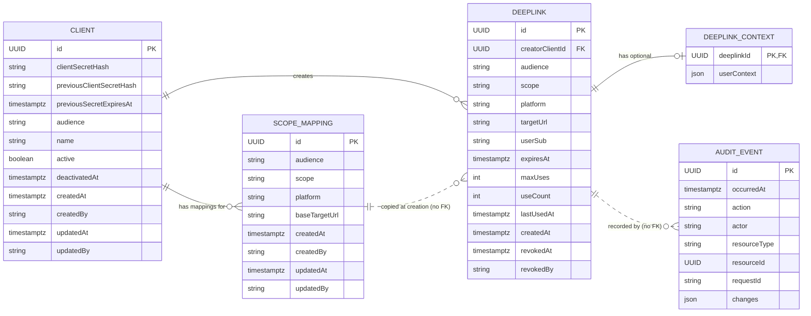

# Data Model

This document defines the data model for the Deeplink Service.
It includes the conceptual entities, their relationships, and the database schema structure.

The model supports:

- Multiple clients (creator and audience applications)
- Audience/scope/platform mappings
- Deeplinks with a bounded TTL, a configurable usage limit (single‑use by default, optionally multi‑use), and optional private user binding
- Size-capped user context stored as a JSON/document column, separated from the deep link record itself

## Entity‑Relationship Diagram (ERD)

## Entities

### Client

Represents an application that interacts with the Deeplink Service.

| Field | Type | Notes |
| --- | --- | --- |
| ``id`` | UUID | Primary key. This is the ``client_id`` the client authenticates with in Basic Auth (see DeepLink.id notes on UUID version) |
| ``clientSecretHash`` | VARCHAR | Hash of the current client secret (see Client Notes on secrets and rotation) |
| ``previousClientSecretHash`` | VARCHAR? | Hash of the prior secret, still accepted during a rotation grace period; null outside of one |
| ``previousSecretExpiresAt`` | TIMESTAMP? | When ``previousClientSecretHash`` stops being accepted; null unless a rotation is in progress |
| ``audience`` | VARCHAR | Logical routing identifier (unique, immutable), e.g. ``onboarding-service`` |
| ``name`` | VARCHAR | Human‑readable name |
| ``active`` | BOOLEAN | Defaults to ``true``. See Client Notes on deactivation |
| ``deactivatedAt`` | TIMESTAMP? | Null while ``active``; set when the client is deactivated |
| ``createdAt`` | TIMESTAMP | See [Audit Fields](#audit-fields) |
| ``createdBy`` | VARCHAR | See [Audit Fields](#audit-fields) |
| ``updatedAt`` | TIMESTAMP | See [Audit Fields](#audit-fields) |
| ``updatedBy`` | VARCHAR | See [Audit Fields](#audit-fields) |

#### Client Notes

- ``id`` doubles as the public ``client_id``. It is generated by the service and carries no meaning; the human-readable identifier is ``audience``.
- ``audience`` is unique and used to route deep links to the correct client.
- Client secrets are generated by the service from a cryptographically secure random source, with at least 256 bits of entropy. They are returned once, at creation or rotation, and never stored in plaintext. Clients can't choose their own secret.
- Because the secret is random and high-entropy, it can't be brute-forced from its hash, so a slow password hash (argon2/bcrypt/scrypt) is not needed. ``clientSecretHash`` is a keyed hash (e.g. HMAC-SHA-256 with a server-side key held outside the database), so a database-only leak doesn't allow offline checking of candidate secrets either. This keeps verification cheap on every call.
- Secrets are compared in constant time.
- The stored value is self-describing (it encodes the algorithm and key version, not just the digest), so verification can accept more than one scheme during a migration or a server-key rotation, without a coordinated cutover across every row.
- Secret rotation uses the two-slot ``clientSecretHash``/``previousClientSecretHash`` pair rather than an unbounded history. Rotating moves the current hash into ``previousClientSecretHash`` (with an operator-chosen ``previousSecretExpiresAt``), installs the new hash, and Basic Auth accepts either until the grace period ends. Integrators get a window to roll out the new secret without a hard cutover. Rotation is an operator action on the internal API (see [API Contract](api_v1.md#clients)).
- Clients are never hard-deleted. ``ScopeMapping.audience`` FKs to ``Client.audience`` and ``DeepLink.creatorClientId`` FKs to ``Client.id``, and audit events reference clients by id, so a hard delete would either violate the FKs or silently orphan that history. Deactivation (``active = false``) is the retirement mechanism instead: a deactivated client fails authentication and is excluded from routing lookups going forward, but its row and every row that references it remain intact.
- This is the same pattern used for audience rotation (see ScopeMapping Notes below): retire in place, let old references keep resolving, rather than forcing an immediate cutover.

### ScopeMapping

Defines which audience + scope + platform maps to which base URL.

| Field | Type | Notes |
| --- | --- | --- |
| ``id`` | UUID | Primary key (see DeepLink.id notes on UUID version) |
| ``audience`` | VARCHAR | **FK to Client.audience** |
| ``scope`` | VARCHAR | Logical flow identifier |
| ``platform`` | ENUM(WEB, ANDROID, IOS) | Target platform |
| ``baseTargetUrl`` | VARCHAR | URL or app URI. May contain query parameters, but not the reserved ``deeplinkId``/``private`` names (see [Architecture § Target URL Construction](architecture.md#target-url-construction)) |
| ``createdAt`` | TIMESTAMP | See [Audit Fields](#audit-fields) |
| ``createdBy`` | VARCHAR | See [Audit Fields](#audit-fields) |
| ``updatedAt`` | TIMESTAMP | See [Audit Fields](#audit-fields) |
| ``updatedBy`` | VARCHAR | See [Audit Fields](#audit-fields) |

#### Constraints

- Unique ``(audience, scope, platform)`` tuple ensures deterministic URL resolution.
- Used to resolve the target URL during deep link creation.
- ``audience`` references ``Client.audience`` rather than ``Client.id``, since mapping resolution is driven by the audience string received on the wire, avoiding an extra join through ``Client`` to translate a client ID first.

#### ScopeMapping Notes

- The ``(audience, scope, platform)`` tuple is immutable; only ``baseTargetUrl`` can be updated. A different tuple is a different mapping.
- A mapping can be hard-deleted. ``DeepLink`` copies the resolved URL at creation and has no FK to ``ScopeMapping``, so existing links are unaffected, and the removal is recorded as an audit event.
- Audience rotation is not supported: once set, a client's ``audience`` is not updated in place. If a client absolutely must change its audience, the pattern is to provision a new ``Client`` (with its own ``audience`` and mappings), let consumers migrate to it at their own pace, and deactivate (not delete — see Client Notes above) the old ``Client`` once migration is complete.

### DeepLink

Represents a deep link instance.

| Field | Type | Notes |
| --- | --- | --- |
| ``id`` | UUID | Primary key (linkId); see Notes on UUID version |
| ``creatorClientId`` | UUID | **FK to Client.id**. Also serves as the link's creator for audit purposes |
| ``audience`` | VARCHAR | Logical routing identifier |
| ``scope`` | VARCHAR | Logical flow identifier |
| ``platform`` | ENUM | Logical platform identifier |
| ``targetUrl`` | VARCHAR | Fully resolved URL with query params |
| ``userSub`` | VARCHAR? | User subject the link is bound to. Set only for private links; a link is private exactly when this is set |
| ``expiresAt`` | TIMESTAMP | ``createdAt`` + requested TTL. Always set, at most one year after ``createdAt`` |
| ``maxUses`` | INT | Usage limit; defaults to 1 (single‑use). Between 1 and 10 |
| ``useCount`` | INT | Starts at 0; incremented atomically on each successful resolution |
| ``lastUsedAt`` | TIMESTAMP? | Null until first resolved; updated alongside ``useCount`` on each successful resolution |
| ``createdAt`` | TIMESTAMP | Creation timestamp |
| ``revokedAt`` | TIMESTAMP? | Null unless the link has been explicitly revoked (see [API Contract](api_v1.md)) |
| ``revokedBy`` | VARCHAR? | Actor that revoked the link; set together with ``revokedAt``. See [Audit Fields](#audit-fields) |

#### DeepLink Notes

- ``id`` should be generated as a UUID v7 (time-ordered) rather than v4. `DeepLink` is the highest-volume, insert-heavy table in this model, and v7's monotonically increasing prefix avoids random-order inserts into the primary key index, keeping writes append-mostly instead of causing page splits across the whole index range. `Client.id` and `ScopeMapping.id` can remain UUID v4, since those tables are low-volume reference data. This is an implementation detail, not a schema constraint — the id generation strategy depends on the target datastore/driver at implementation time (e.g. application-level generation vs. a database-native function), and is left to the developer to decide when choosing the persistence layer.
  - `id` is also the public `linkId` returned to creators/audiences — there is no separate opaque token. This means its leading bits encode the link's creation timestamp, decodable by anyone holding the link. That doesn't grant any new *access*: the random component is still on the order of 74 bits (well beyond brute-force range, online or offline), and resolving or checking status still requires the caller to already be the link's creator or audience client.
- The link's privacy is derived from ``userSub`` rather than stored separately, so the two can never disagree. The API still exposes it as a ``private`` boolean.
- The requested TTL is not stored. Only ``expiresAt`` matters at resolution time, and the TTL can be recovered as ``expiresAt - createdAt``.
- A link is exhausted once ``useCount`` reaches ``maxUses``; resolution treats an exhausted link the same as an expired one.
- A link with ``revokedAt`` set is treated identically to an expired/exhausted link at resolution time. Revocation is a soft delete: the row, its `useCount`/`lastUsedAt` history, and its `DeepLinkContext` (if any) are left intact until the retention/purge job removes them.
- ``useCount`` increments must be atomic (e.g. a conditional ``UPDATE ... WHERE useCount < maxUses AND revokedAt IS NULL AND expiresAt > now()`` or equivalent) to avoid race conditions when a link near its limit is resolved, or revoked, concurrently.

### DeepLinkContext

Holds optional metadata associated with a deep link, separated from `DeepLink` itself.

| Field | Type | Notes |
| --- | --- | --- |
| ``deeplinkId`` | UUID | Primary key; **FK to DeepLink.id**, deleted together with its link |
| ``userContext`` | JSON | Arbitrary metadata, at most 16 KiB serialized (`JSONB` in engines that support it, e.g. Postgres) |

#### DeepLinkContext Notes

- Modeled as a 1:1 extension of `DeepLink` rather than a column on it, since `userContext` is write‑once/read‑once, comparatively large, and never filtered or aggregated on — unlike the rest of `DeepLink`, which is scanned for lookups, listing, and purge.
- Keeping it in a separate table bounds the row size of the high‑volume `DeepLink` table, and scopes any future column‑level encryption (and the size growth that comes with ciphertext overhead) to this table alone rather than the hottest table in the model.
- Absence of a row means no context was provided; no need for a nullable column.
- If encryption of `userContext` is introduced, whole‑value encryption produces opaque ciphertext that is no longer valid JSON, so the column type would change to a binary/blob type (or a text type if base64‑encoded) at that point. This has no practical downside here, since the model never queries inside the JSON structure.

### AuditEvent

An append-only record of one audited action (see [Architecture § Audit](architecture.md#audit)).

| Field | Type | Notes |
| --- | --- | --- |
| ``id`` | UUID | Primary key, UUID v7 (insert-heavy, like ``DeepLink``) |
| ``occurredAt`` | TIMESTAMP | When the action happened, set by the service |
| ``action`` | VARCHAR | Action name, e.g. ``link.created``, ``link.resolved``, ``link.revoked``, ``link.revoke_noop``, ``link.purged``, ``client.created``, ``client.updated``, ``client.secret_rotated``, ``client.deactivated``, ``scope_mapping.created``, ``scope_mapping.updated``, ``scope_mapping.deleted`` |
| ``actor`` | VARCHAR | Actor identifier, same format as the entity audit fields (see [Audit Fields](#audit-fields)) |
| ``resourceType`` | VARCHAR | ``deeplink``, ``client``, or ``scope_mapping`` |
| ``resourceId`` | UUID | Id of the affected row |
| ``requestId`` | VARCHAR? | Request/correlation id; null for system jobs |
| ``changes`` | JSON? | For updates, the changed fields before and after. For private-link resolution, the user ``sub``. Null otherwise |

#### AuditEvent Notes

- Append-only: the service only inserts. The database role the service runs as should have no ``UPDATE`` or ``DELETE`` permission on this table, so the rule doesn't rely on application code alone. Removal past the audit retention window is done by a separate retention process with its own permissions.
- No foreign keys. ``resourceId`` must stay valid after the link purge job deletes a ``DeepLink``, so it is a plain id, not a reference.
- Written in the same transaction as the state change it records.
- ``changes`` never contains ``userContext``, secrets, secret hashes, or tokens.

## Audit Fields

Entity audit fields record the current state of a row: when it was created and last changed, and by whom. The full history of changes is kept by audit events (see [Architecture § Audit](architecture.md#audit)), not by these fields.

- ``createdAt`` / ``updatedAt`` are set by the service, never accepted from callers. ``updatedAt`` equals ``createdAt`` until the first update.
- ``createdBy`` / ``updatedBy`` / ``revokedBy`` hold an actor identifier as ``<actorType>:<id>``: ``client:<Client.id>``, ``operator:<IdP sub>``, or ``system:<job name>`` (e.g. ``system:retention-job``). Audit events use the same identifier (see [Architecture § Audit](architecture.md#audit)).
- ``Client`` and ``ScopeMapping`` carry the full set, since they are mutable reference data changed by operators.
- ``DeepLink`` does not need ``createdBy``, ``updatedAt`` or ``updatedBy``. Its creator is ``creatorClientId``, and its only mutations already have dedicated fields: resolution (``useCount``/``lastUsedAt``) and revocation (``revokedAt``/``revokedBy``). A generic ``updatedAt`` would also be rewritten on every resolve of the hottest table without adding information.
- ``DeepLinkContext`` is write-once with its parent ``DeepLink``, so the parent's fields cover it.

## Indexing Strategy

### DeepLink Indexes

| Index | Serves |
| --- | --- |
| Primary key ``(id)`` | Resolve, status and revoke lookups by ``linkId``. Also the internal list API's cursor pagination and its ``createdAfter``/``createdBefore`` filter, since a UUID v7 range is a creation-time range |
| ``idx_deeplink_audience_id`` on ``(audience, id)`` | Internal list API filtered by ``audience``, keeping cursor order without a sort |
| ``idx_deeplink_creatorclientid_id`` on ``(creatorClientId, id)`` | Internal list API filtered by ``creatorClientId``, same reasoning |
| ``idx_deeplink_expiresat`` on ``(expiresAt)`` | Purge job: expired links |
| ``idx_deeplink_exhausted`` on ``(lastUsedAt)``, partial ``WHERE useCount >= maxUses`` | Purge job: exhausted links. Partial, since most rows aren't exhausted |
| ``idx_deeplink_revokedat`` on ``(revokedAt)``, partial ``WHERE revokedAt IS NOT NULL`` | Purge job: revoked links. Partial, since most rows are never revoked |

No index is needed for the audience check or the status check at resolution: both run on the single row already loaded by primary key.

When the internal list API combines the ``audience`` and ``creatorClientId`` filters, one index is used and the other is filtered on. That's acceptable for an ops tool, and avoids a composite index for a rare query.

### AuditEvent Indexes

Primary key ``(id)`` only. Since ``id`` is a UUID v7, a time window maps to an id range, so the primary key serves:

- Audit queries, which always require a time window (see [API Contract § Audit Events](api_v1.md#audit-events)). Filters on resource, actor, or action are applied to the rows inside that window, without an index of their own.
- Retention removal by id range.

No secondary indexes, deliberately. Audit events are written on the hot path, including every successful resolve, while reading them is a rare ops task that can afford to be slow. An index on ``(resourceType, resourceId)`` would be the costly kind, since ``resourceId`` values arrive in random order and each insert would touch a random index page. The required time window keeps every read a bounded range scan instead of a full-table scan. Add a secondary index only if audit queries become frequent enough to justify the write cost.

### ScopeMapping Indexes

- Unique index on ``(audience, scope, platform)``: ensures deterministic mapping and serves creation lookups. Its leading ``audience`` column also serves the internal list API filtered by ``audience``.

### Client Indexes

- Unique index on ``(audience)``: ensures uniqueness and serves the ``ScopeMapping.audience`` FK.

## Related Documents

- [Architecture](architecture.md)
- [Flows](flows/flows.md)
- [Implementation Notes](implementation_notes.md)
- [Future Improvements](future_improvements.md)
