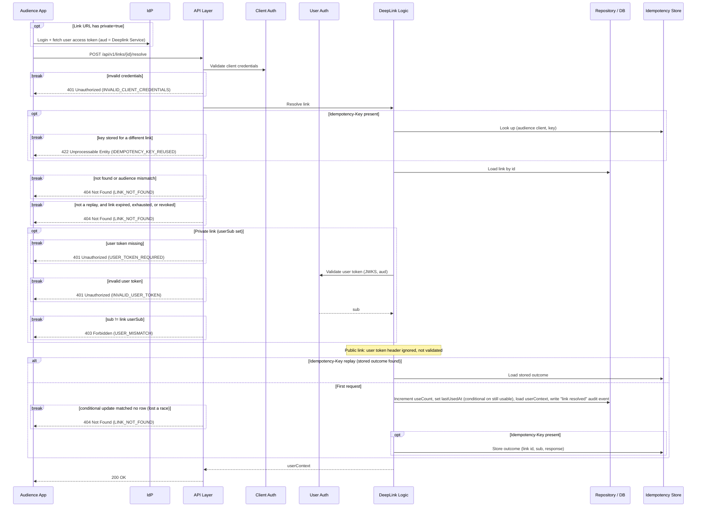

# Resolution Flow

This document defines the flow for resolving deep links using the Deeplink Service. Each `break` block is an early exit: the request stops there with the shown response. Checks run in the order shown (see [Architecture § Resolution](../architecture.md#resolution)).

